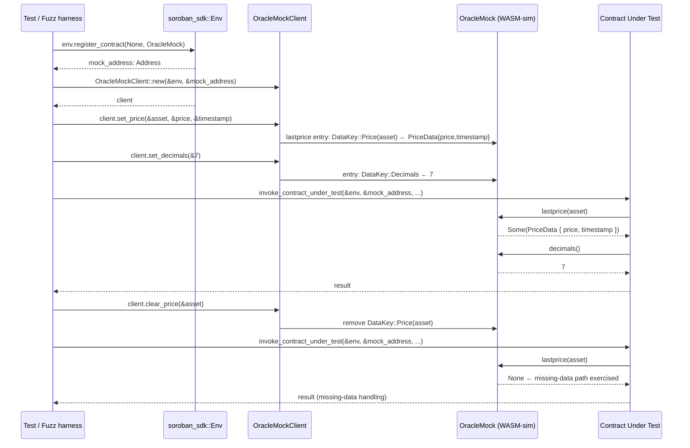

# Design Document

## Feature: oracle-mock-price-feed

## Overview

This design scaffolds the `contracts/oracle-client` crate, which provides two things:

1. **`IReflectorOracle` trait + `PriceData` type** (`src/lib.rs`): a stopgap interface definition
   that mirrors the Reflector on-chain oracle. It is explicitly marked as temporary and will be
   replaced when issue #0417 lands. The mock in `src/mock.rs` is designed to remain unchanged
   through that replacement.

2. **`OracleMock` contract** (`src/mock.rs`): a fully configurable `#[contract]` / `#[contractimpl]`
   Soroban test double. It stores per-asset price data and a global decimal precision in persistent
   storage, exposes setter/clearer methods alongside the Reflector interface methods, and is
   cfg-gated so it never appears in release WASM artifacts.

The design follows the established mock pattern from `contracts/keeper-registry/src/mocks.rs` and
the `#[contractclient]` trait pattern from `contracts/keeper-registry/src/verifier.rs`.

---

## Architecture

```
contracts/oracle-client/
├── Cargo.toml                  # package oracle-client; crate-type cdylib+rlib;
│                               #   feature: testutils
└── src/
    ├── lib.rs                  # IReflectorOracle (#[contractclient]), PriceData (#[contracttype])
    │                           # STOPGAP: replaced by #0417
    └── mock.rs                 # #[cfg(any(test, fuzzing))]
                                # OracleMock #[contract] + #[contractimpl]
```

Consumers (integration tests, fuzz targets) in other workspace crates add:

```toml
# In their Cargo.toml [dev-dependencies]
oracle-client = { path = "../oracle-client", features = ["testutils"] }
```

No workspace-level `Cargo.toml` membership until #0417 lands (Requirement 7.4).

---

## Components and Interfaces

### `src/lib.rs` — Interface and Types (Stopgap)

Declares:
- `PriceData` struct annotated with `#[contracttype]` and `#[derive(Clone, Debug)]`
- `IReflectorOracle` trait annotated with `#[contractclient(name = "ReflectorClient")]`
  which causes the Soroban macro to generate a `ReflectorClient` typed-client struct

This file is explicitly marked `// STOPGAP: replaced by #0417` so the replacement is
discoverable. The trait's method signatures must be stable across the replacement.

### `src/mock.rs` — OracleMock Contract

Cfg-gated with `#![cfg(any(test, fuzzing))]` at the top of the file, matching the pattern
established by `contracts/keeper-registry/src/mocks.rs`.

Provides:
- `DataKey` enum (`#[contracttype]`) with two variants: `Price(Symbol)` and `Decimals`
- `OracleMock` struct (`#[contract]`)
- `#[contractimpl]` block with both interface methods and setter/clearer methods

The Soroban macro also generates `OracleMockClient` for test code to call all methods,
including setters, without raw `env.invoke_contract`.

---

## Data Models

### `PriceData`

```rust
#[contracttype]
#[derive(Clone, Debug)]
pub struct PriceData {
    pub price: i128,
    pub timestamp: u64,
}
```

`#[contracttype]` is required so this struct can cross the Soroban host ABI boundary
(i.e., be serialised/deserialised as XDR when stored and returned from contract calls).

### `DataKey`

```rust
#[contracttype]
#[derive(Clone)]
enum DataKey {
    Price(Symbol),   // per-asset: stores PriceData
    Decimals,        // global: stores u32
}
```

`#[contracttype]` is required so enum discriminants are serialised consistently as XDR
across the WASM boundary. `Price(Symbol)` carries the asset identifier as the key
discriminant, giving O(1) per-asset reads/writes with no secondary index.

---

## API Surface

### `IReflectorOracle` trait (in `src/lib.rs`)

```rust
#[contractclient(name = "ReflectorClient")]
pub trait IReflectorOracle {
    /// Returns the most recently stored price data for `asset`,
    /// or `None` if no price has been set.
    fn lastprice(env: Env, asset: Symbol) -> Option<PriceData>;

    /// Returns the global decimal precision (e.g. 7 for Reflector's default).
    fn decimals(env: Env) -> u32;
}
```

### `OracleMock` — Interface methods (in `src/mock.rs`)

These implement `IReflectorOracle`:

```rust
// Returns Some(PriceData { price, timestamp }) if set, None otherwise.
pub fn lastprice(env: Env, asset: Symbol) -> Option<PriceData>

// Returns stored decimals, defaulting to 7 if never set.
pub fn decimals(env: Env) -> u32
```

### `OracleMock` — Setter/control methods (in `src/mock.rs`)

Test-only control surface, callable via the generated `OracleMockClient`:

```rust
// Stores PriceData { price, timestamp } under DataKey::Price(asset).
pub fn set_price(env: Env, asset: Symbol, price: i128, timestamp: u64)

// Removes any stored price for asset (causes lastprice to return None).
pub fn clear_price(env: Env, asset: Symbol)

// Stores decimals under DataKey::Decimals.
pub fn set_decimals(env: Env, decimals: u32)
```

The default decimal precision of `7` matches Reflector's on-chain default, so tests that
never call `set_decimals` get a sensible value without extra setup.

---

## Storage Layout

| Storage tier | Key                   | Value type   | Semantics                                         |
|--------------|-----------------------|--------------|---------------------------------------------------|
| Persistent   | `DataKey::Price(sym)` | `PriceData`  | Per-asset price + timestamp; absent = no price    |
| Persistent   | `DataKey::Decimals`   | `u32`        | Global decimal precision; absent defaults to `7`  |

**Missing-data sentinel**: key absence is the canonical missing-data state. There is no
separate sentinel value. `lastprice` reads the key with `get()` and maps `None` (absent)
to the `Option::None` return. `clear_price` removes the key with `remove()`.

**Why persistent storage?** The mock may be used across multiple contract invocations in a
single test (e.g. a task execution that reads price multiple times). Persistent storage
survives across invocations on the same `Env`, instance storage does not.

---

## Cfg-Gating Strategy

```
src/lib.rs
  - Always compiled (no cfg gate)
  - IReflectorOracle + PriceData must be available to callers at all times
  - #[contractclient] derive is gated on feature = "testutils":
    use soroban_sdk::{contractclient, ...}
    #[cfg_attr(feature = "testutils", contractclient(name = "ReflectorClient"))]
    pub trait IReflectorOracle { ... }

src/mock.rs
  - File-level: #![cfg(any(test, fuzzing))]
  - Module declaration in lib.rs:
    #[cfg(any(test, fuzzing))]
    pub mod mock;
```

Gate interaction:

| Build scenario                           | lib.rs compiles? | mock.rs compiles? |
|------------------------------------------|------------------|-------------------|
| `cargo build --release` (wasm32)         | ✓ (no client)    | ✗ (excluded)      |
| `cargo test`                             | ✓ (with client)  | ✓                 |
| `cargo test --features testutils`        | ✓ (with client)  | ✓                 |
| `cargo build --no-default-features`      | ✓ (no client)    | ✗ (excluded)      |
| Fuzz target (`cfg(fuzzing)`)             | ✓ (with client)  | ✓                 |

The `#[contractclient]` derive macro requires `soroban-sdk/testutils` to generate the client
struct; without the feature the trait is still declared (and the mock's `#[contractimpl]`
still satisfies it), callers just cannot construct a typed `ReflectorClient` from lib.rs
directly. Tests always enable `testutils` through `[dev-dependencies]`.

---

## Crate Cargo.toml Specification

```toml
[package]
name = "oracle-client"
version = "0.1.0"
edition = "2021"
authors = ["Soroban Keeper Network Contributors"]
description = "IReflectorOracle interface and OracleMock test double for oracle-dependent contracts"
license = "Apache-2.0"
repository = "https://github.com/soroban-tooling/soroban-keeper-network"

[lib]
# cdylib for the on-chain WASM build; rlib so test/fuzz crates can link
# against it as a library dependency.
crate-type = ["cdylib", "rlib"]

[features]
default = []
testutils = ["soroban-sdk/testutils"]

[dependencies]
soroban-sdk = { version = "22.0.1" }

[lints.rust]
# cargo-fuzz sets cfg(fuzzing) automatically; suppress the check-cfg lint
# that newer rustc emits for unrecognized cfg names.
unexpected_cfgs = { level = "allow", check-cfg = ["cfg(fuzzing)"] }
```

**Not added to the workspace `[members]` array** until issue #0417 lands (Requirement 7.4).
Consumers reference it as a path dev-dependency:

```toml
[dev-dependencies]
oracle-client = { path = "../oracle-client", features = ["testutils"] }
```

---

## Sequence Diagram: Test Using OracleMock



---

## Error Handling

The mock contract has no explicit error returns. All failure paths are exhaustive:

- `lastprice` on an unset asset: returns `Option::None`. The Soroban host never panics
  on `storage().persistent().get()` returning `None` — the SDK returns `None` natively.
- `clear_price` on an already-absent key: `storage().persistent().remove()` is a no-op
  when the key is absent; no panic, no error.
- `decimals` with no stored value: defaults to `7` via `unwrap_or(7)`.
- All setter methods are unconditional writes. There is no validation of inputs — the mock
  accepts any `i128` price and `u64` timestamp, which is intentional so tests can exercise
  extreme edge-case values.

---

## Implementation Notes

### Stopgap lib.rs vs. #0417 replacement contract

The `src/lib.rs` in this scaffold is explicitly temporary:

```rust
// STOPGAP: This file is a minimal interface scaffold added by the
// oracle-mock-price-feed spec (issue #657). It will be replaced when
// issue #0417 lands with the real IReflectorOracle implementation.
// The mock in src/mock.rs is designed to compile unchanged against
// the replacement lib.rs.
```

For the replacement to be drop-in, `IReflectorOracle` must keep the exact same method
signatures and `PriceData` must keep the exact same fields. The `#[contractclient]`
attribute name `"ReflectorClient"` should also be preserved.

### TTL management

The `OracleMock` does not extend storage TTLs. The `ReentrantToken` mock in
`keeper-registry/src/mocks.rs` adds an explicit `extend_ttl_for_test` helper for tests
that fast-forward the ledger. If a test using `OracleMock` similarly needs to jump ledger
sequences (e.g. to test deadline expiry), it must extend TTLs manually or call
`env.ledger().set_sequence_number()` before reading from the mock.

### Why `Symbol` and not `Address` for asset keys?

Reflector uses `Symbol` to identify assets (e.g. `XLM`, `BTC`). The mock mirrors this
exactly so tests that pass the same `Symbol` to both the mock's setter and the contract
under test work without translation.

---

## Testing Strategy

**Dual testing approach**: unit/example tests validate specific concrete scenarios; property-based
tests validate universal invariants across randomised inputs.

### Unit / example tests

- Register `OracleMock`, call `set_price` with a concrete asset/price/timestamp, assert
  `lastprice` returns the expected `Some(PriceData)`.
- Call `set_decimals(18)`, assert `decimals()` returns `18`.
- Call `clear_price` on an asset, assert `lastprice` returns `None`.
- Call `decimals()` on a fresh mock (no `set_decimals`), assert it returns `7`.
- Verify `lastprice` returns `None` for an asset that was never set.

### Property-based tests

All five properties in the Correctness Properties section below are suitable for
property-based testing. Generators should produce:

- `Symbol`: short strings of 1–32 ASCII alphanumeric characters (Soroban `symbol_short!` range)
- `i128`: full range including negative prices (to exercise oracle-dependent logic that guards
  against stale or invalid data)
- `u64`: full range of timestamps
- `u32`: full range of decimal precisions

Each property test should run a minimum of 100 iterations. Test infrastructure uses
`soroban-sdk/testutils` (the `Env::default()` in-process simulator).

**What is not property-tested**: cfg-gating, `crate-type` configuration, `#![no_std]`
compliance, and workspace membership are build-time constraints verified by CI compilation
smoke tests, not by runtime property tests.

---

## Correctness Properties

*A property is a characteristic or behavior that should hold true across all valid executions of
a system — essentially, a formal statement about what the system should do. Properties serve as
the bridge between human-readable specifications and machine-verifiable correctness guarantees.*

### Property 1: Price set–get round-trip

*For any* asset `Symbol`, price `i128`, and timestamp `u64`, calling `set_price(asset, price, timestamp)` on the `OracleMock` followed by `lastprice(asset)` SHALL return `Some(PriceData { price, timestamp })` with exactly the values that were stored.

**Validates: Requirements 1.1, 1.3, 3.5, 6.4**

### Property 2: Decimal set–get round-trip

*For any* `u32` decimal value, calling `set_decimals(decimals)` followed by `decimals()` SHALL return the same value.

**Validates: Requirements 1.2, 1.4**

### Property 3: Last-write wins on repeated set_price

*For any* asset `Symbol` and any two distinct `(price, timestamp)` pairs P1 and P2, calling `set_price(asset, P1.price, P1.timestamp)` then `set_price(asset, P2.price, P2.timestamp)` SHALL cause `lastprice(asset)` to return `Some(PriceData { price: P2.price, timestamp: P2.timestamp })` — only the final write is observable.

**Validates: Requirements 1.5**

### Property 4: Fresh mock returns None for all assets

*For any* asset `Symbol`, on a freshly registered `OracleMock` (before any `set_price` call), `lastprice(asset)` SHALL return `None`.

**Validates: Requirements 2.1, 2.3**

### Property 5: set_price then clear_price restores None

*For any* asset `Symbol`, price `i128`, and timestamp `u64`, calling `set_price(asset, price, timestamp)` followed by `clear_price(asset)` SHALL cause `lastprice(asset)` to return `None` — the clear is complete and no residual data remains.

**Validates: Requirements 2.2, 2.3**
