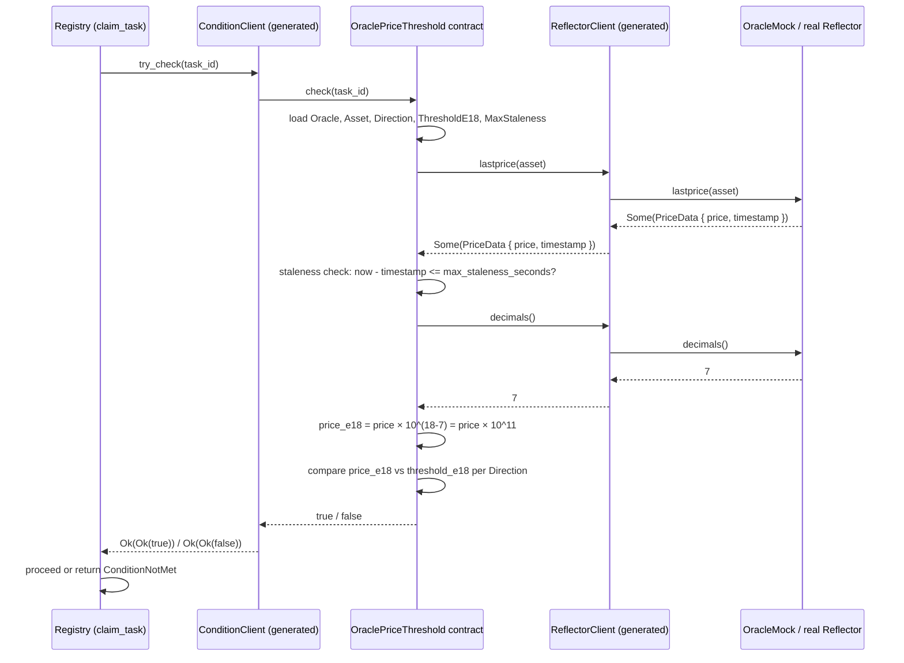

# Design Document

## Feature: oracle-price-threshold-condition

## Overview

This design specifies the `contracts/conditions/oracle-price-threshold/` crate: a Soroban
condition contract that gates a keeper's claim on a task until an asset's price on the
Reflector oracle crosses an owner-configured threshold. It depends on:

- `contracts/oracle-client/` (issues #0417 / #0418): supplies `IReflectorOracle`,
  `ReflectorClient`, `PriceData`, and `OracleMock`.
- The `ICondition` interface: declared in this crate and consumed by the registry's
  `claim_task` (issues #0391–#0393, not yet merged).

The design fills two gaps left by the not-yet-closed issues #0416 and #0390:
**staleness rule** and **normalization arithmetic** are pinned here so they are
unambiguous before any code is written.

---

## Architecture

```
contracts/conditions/oracle-price-threshold/
├── Cargo.toml          # name = "oracle-price-threshold"; crate-type cdylib+rlib
└── src/
    ├── lib.rs          # ICondition trait, OraclePriceThreshold contract,
    │                   # DataKey, Direction, ConditionError, constants
    └── test.rs         # Integration tests using OracleMock
```

Workspace membership: **not** added to the root `[members]` until both #0417 and #0418 are
closed. Until then, consumers reference it as a path dev-dependency:

```toml
[dev-dependencies]
oracle-price-threshold = { path = "../conditions/oracle-price-threshold", features = ["testutils"] }
```

---

## Pinned Design Decisions

### Staleness Rule (fills gap left by #0416)

**Decision:** Fail closed. When `lastprice` returns a timestamp `t` such that
`env.ledger().timestamp() − t > MAX_STALENESS_SECONDS`, `check` returns `false`. The
claim is refused. A future-dated timestamp (`t > env.ledger().timestamp()`) is also
treated as invalid and fails closed.

**Rationale:** The registry's existing posture is conservative throughout (default fee 0,
default min-reward 0, never-silently-wrong). Fail-open on a stale price would let a task
trigger on data that may no longer reflect market reality, which is worse than refusing a
claim that a keeper will simply retry when a fresh tick arrives.

**Staleness window constant:** `MAX_STALENESS_SECONDS = 86_400` (86,400 s ≈ 1 day).
This value is chosen to match `TTL_SAFETY_MARGIN_LEDGERS = 17_280` in `constants.rs`
(17,280 × 5 s/ledger = 86,400 s), ensuring the two safety margins are in sync. Task owners
that need a tighter window can deploy a new condition instance with a smaller
`max_staleness_seconds` passed to `initialize`.

**Exact-boundary behavior:** A price whose age is exactly `max_staleness_seconds` is
considered fresh (inclusive lower bound on staleness: `age > max_staleness_seconds` is
stale, `age == max_staleness_seconds` is fresh).

### Normalization Arithmetic (fills gap left by #0416)

**Decision:** Normalize both the oracle price and the stored threshold to 18-decimal
fixed-point before comparison.

```
price_e18 = price × 10^(18 − oracle_decimals)
```

`threshold_e18` is stored as an `i128` in the same 18-decimal base at `initialize` time.

**Why 18 decimals?** It is the de-facto standard for fixed-point token arithmetic (ERC-20,
Soroban `token::Client`). Storing the threshold in the same base as the normalized price
means the comparison is `price_e18 > threshold_e18` without any runtime formula involving
`oracle_decimals`; the decimals call is only needed to normalize the live price.

**Overflow handling:** `10i128::pow(18 − oracle_decimals)` can overflow `i128` when
`oracle_decimals < 0` (impossible since it is `u32`) or when the product of `price` and the
scale factor exceeds `i128::MAX`. If `checked_mul` returns `None`, `check` returns `false`
(fail closed — treat the normalization failure as an invalid price).

**Oracle decimals > 18:** If `oracle_decimals > 18`, the scaling factor would be a fraction
(`10^(negative_exponent)`), which is not representable in integer arithmetic. `check`
returns `false` in this case. Reflector's documented default is 7; values above 18 are
pathological and treated as invalid.

### Condition Interface (fills gap left by #0390)

**Decision:** The `ICondition` interface is declared in this crate as:

```rust
#[contractclient(name = "ConditionClient")]
pub trait ICondition {
    fn check(env: Env, task_id: u64) -> bool;
}
```

This mirrors `IKeeperVerifier`'s structure exactly (same crate pattern, same bool return,
no auth requirement). The registry's `claim_task` constructs a `ConditionClient` and calls
`try_check`, treating any non-`Ok(Ok(true))` result as `false` — the same pattern
`execute_task` uses for `KeeperVerifierClient::try_verify`.

The `task_id` parameter is passed through so future condition contracts that need to inspect
the task's own fields (owner, deadline, etc.) can do so via a registry view call, without
coupling this interface to registry internals.

### Configuration Storage (immutable after `initialize`)

**Decision:** The contract is configured once via `initialize` and is immutable thereafter.
There are no setter methods. If configuration needs to change, a new contract instance is
deployed and the task owner calls `update_condition` on the registry.

**Rationale:** Mutable configuration would let a task owner silently change the trigger
condition after keepers have evaluated it and decided whether to monitor the task. Immutable
configuration gives keepers a stable evaluation predicate they can cache off-chain.

---

## Components and Interfaces

### `ICondition` Trait

```rust
#[contractclient(name = "ConditionClient")]
pub trait ICondition {
    fn check(env: Env, task_id: u64) -> bool;
}
```

### `Direction` Enum

```rust
#[contracttype]
#[derive(Clone, PartialEq, Eq, Debug)]
pub enum Direction {
    Above = 0,
    Below = 1,
}
```

### `DataKey` Enum

```rust
#[contracttype]
#[derive(Clone)]
pub enum DataKey {
    Oracle,          // Address — configured oracle contract
    Asset,           // Symbol — asset identifier passed to lastprice
    Direction,       // Direction — Above or Below
    ThresholdE18,    // i128 — threshold in 18-decimal fixed-point
    MaxStaleness,    // u64 — max price age in seconds
    Initialized,     // bool — set to true after initialize
}
```

### `ConditionError` Enum

```rust
#[contracterror]
#[derive(Clone, Copy, PartialEq, Eq, Debug)]
pub enum ConditionError {
    AlreadyInitialized = 1,
    NotInitialized     = 2,
    InvalidThreshold   = 3,
}
```

### `OraclePriceThreshold` Contract

Entry points:

```rust
pub fn initialize(
    env: Env,
    oracle: Address,
    asset: Symbol,
    direction: Direction,
    threshold_e18: i128,
    max_staleness_seconds: u64,
) -> Result<(), ConditionError>
```

```rust
pub fn check(env: Env, task_id: u64) -> bool
```

---

## Data Models

### Storage Layout

| Key | Type | Storage tier | Written by | Read by |
|---|---|---|---|---|
| `DataKey::Oracle` | `Address` | Persistent | `initialize` | `check` |
| `DataKey::Asset` | `Symbol` | Persistent | `initialize` | `check` |
| `DataKey::Direction` | `Direction` | Persistent | `initialize` | `check` |
| `DataKey::ThresholdE18` | `i128` | Persistent | `initialize` | `check` |
| `DataKey::MaxStaleness` | `u64` | Persistent | `initialize` | `check` |
| `DataKey::Initialized` | `bool` | Persistent | `initialize` | `initialize`, `check` |

All keys use Persistent storage; `check` writes nothing.

---

## Sequence Diagram: `check` Happy Path



---

## `check` Logic (Pseudo-code)

```rust
pub fn check(env: Env, _task_id: u64) -> bool {
    // 1. Guard: must be initialized
    if !env.storage().persistent().get(&DataKey::Initialized).unwrap_or(false) {
        return false; // uninitialised → fail closed, not a panic
    }

    // 2. Load config
    let oracle: Address     = env.storage().persistent().get(&DataKey::Oracle).unwrap();
    let asset: Symbol       = env.storage().persistent().get(&DataKey::Asset).unwrap();
    let direction: Direction = env.storage().persistent().get(&DataKey::Direction).unwrap();
    let threshold: i128     = env.storage().persistent().get(&DataKey::ThresholdE18).unwrap();
    let max_stale: u64      = env.storage().persistent().get(&DataKey::MaxStaleness).unwrap();

    // 3. Fetch price
    let oracle_client = ReflectorClient::new(&env, &oracle);
    let price_data = match oracle_client.lastprice(&asset) {
        Some(pd) => pd,
        None => return false, // missing price → fail closed
    };

    // 4. Staleness check
    let now = env.ledger().timestamp();
    if price_data.timestamp > now {
        return false; // future-dated → fail closed
    }
    if now - price_data.timestamp > max_stale {
        return false; // stale → fail closed
    }

    // 5. Normalize
    let oracle_decimals = oracle_client.decimals();
    if oracle_decimals > 18 {
        return false; // pathological feed → fail closed
    }
    let scale: i128 = match 10i128.checked_pow(18 - oracle_decimals) {
        Some(s) => s,
        None => return false, // overflow → fail closed
    };
    let price_e18: i128 = match price_data.price.checked_mul(scale) {
        Some(p) => p,
        None => return false, // overflow → fail closed
    };

    // 6. Direction comparison (strict; equality is not a crossing)
    match direction {
        Direction::Above => price_e18 > threshold,
        Direction::Below => price_e18 < threshold,
    }
}
```

---

## Constants

```rust
/// Default maximum price age in seconds. Matches TTL_SAFETY_MARGIN_LEDGERS
/// (17,280 × 5 s/ledger = 86,400 s) from contracts/keeper-registry/src/constants.rs.
pub const MAX_STALENESS_SECONDS: u64 = 86_400;

/// Instance-storage TTL bump after initialize, matching INSTANCE_BUMP_LEDGERS
/// in the registry.
pub const CONDITION_BUMP_LEDGERS: u32 = 100_000;
pub const CONDITION_BUMP_THRESHOLD: u32 = 50_000;
```

---

## Crate `Cargo.toml`

```toml
[package]
name = "oracle-price-threshold"
version = "0.1.0"
edition = "2021"
authors = ["Soroban Keeper Network Contributors"]
description = "Reflector-backed price-threshold condition contract for the keeper registry"
license = "Apache-2.0"
repository = "https://github.com/soroban-tooling/soroban-keeper-network"

[lib]
crate-type = ["cdylib", "rlib"]

[features]
default = []
testutils = ["soroban-sdk/testutils", "oracle-client/testutils"]

[dependencies]
soroban-sdk = { version = "22.0.1" }
oracle-client = { path = "../../oracle-client" }

[lints.rust]
unexpected_cfgs = { level = "allow", check-cfg = ["cfg(fuzzing)"] }
```

---

## Error Handling

| Situation | Behavior | Reasoning |
|---|---|---|
| `check` called before `initialize` | Returns `false` | Fail closed; uninitialised contract cannot be trusted |
| `lastprice` returns `None` | Returns `false` | Missing price ≡ stale |
| Future-dated timestamp | Returns `false` | Invalid data treated as unavailable |
| Price age > `max_staleness_seconds` | Returns `false` | Stale price fails closed |
| `oracle_decimals > 18` | Returns `false` | Pathological feed; integer arithmetic undefined |
| `checked_mul` overflows | Returns `false` | Extreme price value treated as invalid |
| `initialize` called twice | Returns `ConditionError::AlreadyInitialized` | Config immutable |
| `threshold_e18 < 0` | Returns `ConditionError::InvalidThreshold` | Negative thresholds are nonsensical for price comparisons |

---

## Testing Strategy

Tests live in `src/test.rs`, use `soroban_sdk::Env::default()`, register the
`OraclePriceThreshold` contract and an `OracleMock` on the same `Env`, call `initialize`
with a controlled configuration, then exercise every branch of `check`.

### Unit tests

| Test name | What it covers |
|---|---|
| `test_above_direction_crosses_threshold` | `Above`, price > threshold → `true` |
| `test_above_direction_below_threshold` | `Above`, price < threshold → `false` |
| `test_below_direction_crosses_threshold` | `Below`, price < threshold → `true` |
| `test_below_direction_above_threshold` | `Below`, price > threshold → `false` |
| `test_price_at_boundary_returns_false` | `price_e18 == threshold_e18`, both directions → `false` |
| `test_staleness_boundary_fresh` | `now - timestamp == max_staleness_seconds` → comparison result |
| `test_staleness_boundary_stale` | `now - timestamp == max_staleness_seconds + 1` → `false` |
| `test_missing_price_returns_false` | `lastprice` returns `None` → `false` |
| `test_future_dated_price_returns_false` | `timestamp > now` → `false` |
| `test_oracle_decimals_7` | normalization with 7 decimals (Reflector default) |
| `test_oracle_decimals_18` | normalization with 18 decimals (scale factor = 1) |
| `test_oracle_decimals_gt_18` | `oracle_decimals = 19` → `false` |
| `test_uninitialized_check_returns_false` | `check` before `initialize` → `false` |
| `test_double_initialize_errors` | second `initialize` → `ConditionError::AlreadyInitialized` |
| `test_negative_threshold_rejected` | `initialize` with `threshold_e18 < 0` → `ConditionError::InvalidThreshold` |
| `test_custom_staleness_window` | `max_staleness_seconds = 3600` (non-default) enforced correctly |

---

## Correctness Properties

### Property 1: Stale price always fails closed

*For any* oracle decimal precision, direction, and threshold, if
`env.ledger().timestamp() − PriceData.timestamp > max_staleness_seconds`, then `check`
SHALL return `false`.

**Validates: Requirements 3.3, 3.5**

### Property 2: Missing price always fails closed

*For any* configuration, if `lastprice` returns `None`, then `check` SHALL return `false`.

**Validates: Requirements 3.2**

### Property 3: Above/Below symmetry

*For any* `price_e18` strictly above `threshold_e18`: `check` with `Direction::Above`
returns `true` and `check` with `Direction::Below` returns `false`. Conversely for prices
strictly below `threshold_e18`.

**Validates: Requirements 4.4, 4.5**

### Property 4: Equality is never a crossing

*For any* configuration where `price_e18 == threshold_e18`, `check` SHALL return `false`
regardless of direction.

**Validates: Requirements 4.6**

### Property 5: Normalization round-trip for oracle_decimals ≤ 18

*For any* `price: i128`, `oracle_decimals: u32` where `oracle_decimals ≤ 18` and the
product does not overflow, `price_e18 == price * 10^(18 - oracle_decimals)`.

**Validates: Requirements 4.1, 4.2**

### Property 6: Future-dated timestamp always fails closed

*For any* `PriceData.timestamp > env.ledger().timestamp()`, `check` SHALL return `false`.

**Validates: Requirements 3.4**
