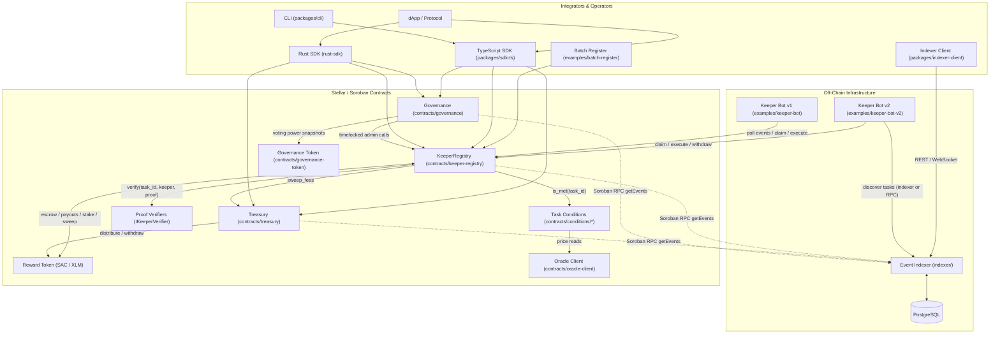

# Architecture

This document describes how the Soroban Keeper Network fits together across its on-chain contracts, off-chain services, SDKs, and bots, along with the invariants enforced by the contracts.

## System Component Diagram



## Components

| Component | Location | README / Docs | Role |
|---|---|---|---|
| **KeeperRegistry contract** | `contracts/keeper-registry` | [README.md](../README.md) | Core on-chain coordination: task lifecycle, escrow, fee accounting, staking/slashing, reputation, verifier & condition hooks, admin controls |
| **Treasury contract** | `contracts/treasury` | [contracts/treasury/README.md](../contracts/treasury/README.md) | Receives swept protocol fees and splits them across up to 10 recipients by fixed basis-point shares |
| **Governance contract** | `contracts/governance` | [docs/GOVERNANCE_DESIGN.md](GOVERNANCE_DESIGN.md) | Token-weighted proposals, snapshotted voting, timelocked execution of enumerated `KeeperRegistry` admin actions |
| **Governance token** | `contracts/governance-token` | [docs/GOVERNANCE_DESIGN.md](GOVERNANCE_DESIGN.md) | Voting-power token read by the governance contract |
| **Oracle client** | `contracts/oracle-client` | [contracts/oracle-client/README.md](../contracts/oracle-client/README.md) | Shared oracle price-feed client used by oracle-backed task conditions |
| **Task conditions** | `contracts/conditions/` | [docs/TASK_CONDITIONS_DESIGN.md](TASK_CONDITIONS_DESIGN.md) | Reference `ITaskCondition` contracts (`price-threshold`, `oracle-deviation`, `time-window`) evaluated before `claim_task` |
| **Verifier test support** | `contracts/verifiers/test-support` | [contracts/verifiers/test-support/README.md](../contracts/verifiers/test-support/README.md) | Reference/mock `IKeeperVerifier` contracts for testing proof verification |
| **Event indexer** | `indexer/` | [indexer/README.md](../indexer/README.md) | Polls Soroban RPC `getEvents`, stores raw events in PostgreSQL, builds queryable task/keeper/admin/governance projections, serves REST & WebSocket APIs |
| **Keeper Bot v2** | `examples/keeper-bot-v2` | [examples/keeper-bot-v2/README.md](../examples/keeper-bot-v2/README.md) | Production TypeScript keeper bot with indexer/RPC task discovery, condition evaluation, profitability ranking, multi-account management, SQLite state, and metrics |
| **Keeper Bot v1 (example)** | `examples/keeper-bot` | [examples/keeper-bot/EXAMPLES.md](../examples/keeper-bot/EXAMPLES.md) | Lightweight reference JavaScript keeper bot |
| **Batch register helper** | `examples/batch-register` | [examples/batch-register/README.md](../examples/batch-register/README.md) | Task-owner CLI helper for submitting `batch_register_tasks` from CSV/JSON |
| **TypeScript SDK** | `packages/sdk-ts` | [packages/sdk-ts/README.md](../packages/sdk-ts/README.md) | Typed TypeScript client for `KeeperRegistry`, `Treasury`, and `Governance`, plus React hooks |
| **Rust SDK** | `rust-sdk/` | [rust-sdk/README.md](../rust-sdk/README.md) | Typed Rust client and cross-contract helpers for `KeeperRegistry`, `Treasury`, and `Governance` |
| **Indexer client** | `packages/indexer-client` | [packages/indexer-client/README.md](../packages/indexer-client/README.md) | Typed TypeScript client for querying the indexer REST and WebSocket APIs |
| **CLI** | `packages/cli` | [packages/cli/README.md](../packages/cli/README.md) | Command-line interface for operators and developers to inspect and interact with the network |
| **Deploy / utility scripts** | `scripts/` | [docs/DEPLOYING.md](DEPLOYING.md) | Build, optimize, deploy, resource-cost reporting, and fuzzing scripts |

## End-to-End Data Flow

1. **Task registration:** A dApp or operator calls `register_task` or `batch_register_tasks` (directly, via `packages/sdk-ts`, `rust-sdk`, `packages/cli`, or `examples/batch-register`). The registry pulls the escrowed reward from the owner via the reward token contract, stores `Task(id)`, and emits `TaskRegistered` (and `VerifierAttached` if a verifier is set).
2. **Event indexing:** `indexer/` continuously polls Soroban RPC `getEvents` with a persisted cursor, writes idempotent raw event rows to PostgreSQL, updates `tasks`, `keepers`, `admin_state`, and governance projections, and exposes them over REST and WebSocket (`packages/indexer-client`).
3. **Discovery, condition & profitability check:** `examples/keeper-bot-v2` (or `examples/keeper-bot`) discovers pending tasks via the indexer or RPC, evaluates any attached `ITaskCondition`, checks verifier support, and runs `estimateTaskProfitability` (see [docs/ECONOMICS.md](ECONOMICS.md)) to rank profitable candidates.
4. **Claim & execution:** The winning keeper calls `claim_task(task_id)`. The registry checks pause state, minimum stake, reputation floor, and any `ITaskCondition::is_met(task_id)` callback, then locks the task for `lock_ledgers`. The keeper performs the off-chain/target action and submits `execute_task(task_id, proof)`. If a verifier is attached, `IKeeperVerifier::verify` must return `true` before any state mutation.
5. **Settlement & fee routing:** `execute_task` splits the reward into `keeper_net` (credited to `KeeperReward` or `PendingReward` if a dispute window is active) and `protocol_fee` (added to `FeesAccrued`). Keepers pull earnings via `withdraw_rewards`. The admin sweeps `FeesAccrued` to `contracts/treasury`, where `distribute` allocates shares to configured recipients.
6. **Governance:** When `contracts/governance` is set as the registry's `admin`, token holders propose and vote on enumerated parameter changes using snapshotted voting power, and execute them after the timelock elapses.

Every state transition publishes an event, and events are the query primitive for off-chain indexers and keeper bots. The single canonical event table lives in the [README events section](../README.md#events) and is transcribed from `contracts/keeper-registry/src/events.rs`.

## Task lifecycle

```
                 register_task              claim_task            execute_task (verifier pass)
   dApp/owner ───────────────▶  PENDING ───────────────▶ CLAIMED ───────────────────────────▶ EXECUTED
                                   │                         │ ▲
                       cancel_task │                         │ │ execute_task (verifier reject, retryable)
                                   ▼              expire_task │ │ (returns to CLAIMED for retry)
                               CANCELLED       (deadline      │ │
                                               passes)        ▼ │
                                                           EXPIRED│
                                                                  └──────────────────────────┘
```

- **PENDING** — funded and waiting. Owner may `cancel_task` (refund), `increase_reward` (top up), or `extend_deadline`. If a condition is attached, `claim_task` rejects with `ConditionNotMet` until `ITaskCondition::is_met(task_id)` returns `true`.
- **CLAIMED** — a keeper holds an exclusive lock for `lock_ledgers`. After the window elapses, any keeper may re-claim (prevents squatting). When a task includes a verifier callback and the verifier rejects the execution, the task remains in `CLAIMED` state for retry (retryable failure), distinct from terminal failure states.
- **EXECUTED** — the keeper submitted proof; its net reward is credited to an internal balance (or held in `PendingReward` if a dispute window is configured) and later withdrawn.
- **CANCELLED / EXPIRED** — terminal refund states.

## Storage layout

| Scope | Key | Value |
|-------|-----|-------|
| Instance | `Admin`, `FeeBps`, `Paused`, `TaskCounter`, `RewardToken`, `FeesAccrued`, `MinReward`, `MinStake`, `SlashCounter`, `DisputeWindowLedgers`, `ReputationFloor` | Global config + counters |
| Persistent | `Task(id)` | Full `Task` record (including optional `verifier` and `condition`) |
| Persistent | `KeeperReward(addr)` | A keeper's withdrawable balance |
| Persistent | `PendingReward(addr)` | Execution credits held during an active dispute window |
| Persistent | `KeeperStake(addr)` | A keeper's bonded stake |
| Persistent | `UnbondRequest(addr)` | Pending unbond `(amount, unlock_ledger)` |
| Persistent | `Slash(id)` / `SlashHistory(addr)` | Individual slash record and per-keeper aggregate |
| Persistent | `Reputation(addr)` | Keeper reputation counters and last-updated ledger |

## TTL / archival strategy

Soroban archives a storage entry once its TTL reaches zero; an archived entry is inaccessible (every entry point that reads it fails) until explicitly restored. The registry renews TTL per storage class as follows:

| Scope | Key | Renewed on | Amount |
|-------|-----|------------|--------|
| Instance | Global config & counters | Every state-mutating entry point (`register_task`, `claim_task`, `execute_task`, `cancel_task`, `expire_task`, `withdraw_rewards`, staking, admin functions, …) | `extend_ttl(INSTANCE_BUMP_THRESHOLD = 50_000, INSTANCE_BUMP_LEDGERS = 100_000)` |
| Persistent | `Task(id)` | Every write via `save_task` (register, top-up, extend deadline, claim, execute, cancel, expire) | `extend_ttl(task.ttl_ledgers, task.ttl_ledgers)`, caller-supplied per task |
| Persistent | `KeeperReward(addr)`, `PendingReward(addr)`, `KeeperStake(addr)`, `UnbondRequest(addr)`, `Slash(id)`, `SlashHistory(addr)` | On write (credit, zero, stake, unbond, slash, appeal) | `extend_ttl(50_000, 100_000)` |

**Read-only views deliberately do not bump TTL.** Views (`get_task`, `task_count`, `keeper_balance`, `fees_accrued`, `is_paused`, etc.) are simulated by clients for free; giving them a storage-write side effect would mean a "free" call sometimes silently costs real resources. Liveness is kept up by write traffic only.

**`KeeperReward(addr)` is a known asymmetric case.** It is only renewed when written (credited on execution, zeroed on withdrawal). A keeper that executes one task and never interacts again may eventually need `RestoreFootprint` to restore an archived entry; the value is never lost.

## Money invariants

The contract holds exactly the funds it owes. At any time:

```
contract_token_balance == Σ(escrow of PENDING/CLAIMED tasks)
                        + Σ(KeeperReward balances)
                        + Σ(PendingReward balances)
                        + Σ(KeeperStake balances)
                        + FeesAccrued
```

That top-level statement is decomposed into named invariants `I-1` through `I-11` (registry), `T-1` through `T-3` (treasury), and `G-1` through `G-3` (governance). Each is referenced by this identifier elsewhere in the repo (property tests, `contracts/keeper-registry/src/invariants.rs`, fuzz targets) so a single name always means the same check.

- **I-1 — Solvency.** The registry's token balance always equals open task escrow plus credited keeper balances plus pending dispute-window credits plus bonded stakes plus accrued fees.
- **I-2 — Escrow recoverability.** Every escrowed reward has at least one reachable path back out: to the owner via `cancel_task` or `expire_task`, or to a keeper via `execute_task` then `withdraw_rewards`. No state strands funds permanently.
- **I-3 — Single payout.** Each task's reward is paid out exactly once — never zero times, never twice.
- **I-4 — Fee bounding.** The protocol never takes more than `fee_bps` of a reward, and the admin can never sweep more than has accrued. The fee is floored by integer division, so the protocol may take marginally *less* than the nominal rate — never more.
- **I-5 — Escrow isolation.** Admin functions can never touch task escrow or credited keeper balances. `sweep_fees` is bounded by `FeesAccrued` specifically to enforce this.
- **I-6 — Withdrawal liveness.** A keeper's credited balance is always withdrawable, including while the contract is paused.
- **I-7 — Monotonic task ids.** Task ids are unique and never reused (`next_task_id` increments a `u64` counter and never decrements it).
- **I-8 — Verifier trust boundary.** A task's attached verifier (if any) is invoked via `Env::try_invoke_contract` with immutable parameters (`task_id`, `keeper`, `proof`) **before any state mutation** occurs. If it returns `false` or panics, execution fails with no state changes.

### Staking invariants (E06)

- **I-9 — Stake isolation:** Staked funds (`DataKey::KeeperStake`) are never read, credited, or debited by task-lifecycle functions, and task escrow / keeper rewards are never touched by staking functions.
- **I-10 — Bounded slashing:** For any successful `slash`, `amount <= keeper_stake` is checked before any state write or transfer (`SlashExceedsStake` rejects rather than clamping).
- **I-11 — No double-counting of unbonding funds:** `initiate_unbond` records only an `UnbondRequest(amount, unlock_ledger)` without moving tokens or creating a second balance pool; `KeeperStake` is reduced once at `withdraw_stake` time.

### Treasury Invariants (E08)

- **T-1 — Conservation.** Distribution never creates or destroys value.
- **T-2 — Access-control (Recipients).** Only configured recipients ever receive a distribution.
- **T-3 — Access-control (Trigger).** Only the admin or automated sweep path can trigger a distribution.

### Governance Invariants (E09)

- **G-1 — Timelock enforcement.** `execute_proposal` succeeds only when current time `>= proposal.eta`.
- **G-2 — Snapshotted voting power.** Voting power is fixed at proposal creation; post-creation token transfers do not alter vote weights.
- **G-3 — Closed proposal set.** Only enumerated proposal types can be created; no arbitrary-call escape hatch exists.

## Trust model

- **Keepers are permissionless** — anyone can claim and execute (subject to optional `min_stake` and `reputation_floor` configured by admin); correctness is enforced by the contract and optional verifiers/conditions, not a whitelist.
- **Admin** controls fee rate, pause, floors (`min_reward`, `min_stake`, `reputation_floor`), dispute window, slashing, upgrade, and fee sweeping — but can never seize task escrow or keeper earnings. Admin may be transferred to `contracts/governance` for decentralized control.
- **Owners** fund their own tasks and can always recover funds via `cancel_task` (pending) or the permissionless `expire_task` path (after deadline).
