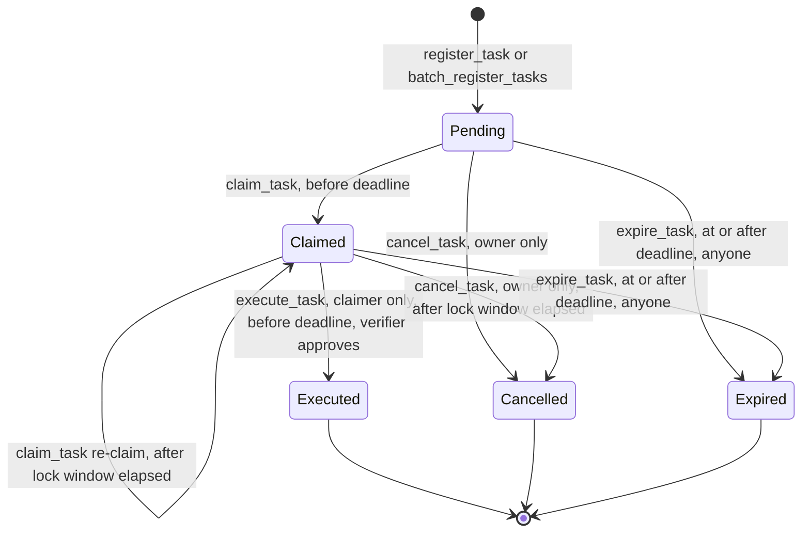

# Task Lifecycle

Every task in the `KeeperRegistry` is a single `Task` record that moves through
five states. This guide explains each state, who may call what in it, the lock
window and deadline rules, what each transition costs, and which entry point and
event mark each transition.

It describes the contract as implemented in
[`contracts/keeper-registry/src/`](../contracts/keeper-registry/src)
(`task.rs`, `internal.rs`, `constants.rs`, `events.rs`, `errors.rs`). When this
document and the code disagree, the code wins; please open an issue.

For the wider picture (money invariants, trust model) see
[ARCHITECTURE.md](ARCHITECTURE.md). For event payload details see the table at the
end of this page.

## Contents

- [The five states](#the-five-states)
- [State diagram](#state-diagram)
- [Transitions](#transitions)
- [The lock window](#the-lock-window)
- [Deadlines](#deadlines)
- [Who can call what in each state](#who-can-call-what-in-each-state)
- [What each transition costs](#what-each-transition-costs)
- [Optional gates: conditions and verifiers](#optional-gates-conditions-and-verifiers)
- [After Executed: the dispute window](#after-executed-the-dispute-window)
- [Events reference](#events-reference)
- [Error reference](#error-reference)

## The five states

`TaskStatus` is defined in `types.rs`:

| State | Value | Meaning | Terminal? |
|-------|-------|---------|-----------|
| `Pending` | 0 | Registered and funded. No keeper holds it. | No |
| `Claimed` | 1 | A keeper holds an exclusive claim for `lock_ledgers` ledgers. | No |
| `Executed` | 2 | The claimer submitted proof and was credited. | Yes |
| `Cancelled` | 3 | The owner withdrew the task and was refunded. | Yes |
| `Expired` | 4 | The deadline passed unexecuted and the owner was refunded. | Yes |

A task is created in `Pending` by `register_task` (or `batch_register_tasks`).
There is no `Failed` state: a rejected execution (for example a verifier that
returns `false`) is a failed call that leaves the task exactly as it was, still
`Claimed` and retryable.

The escrowed `reward` is held by the registry from registration until the task
leaves `Pending`/`Claimed`, and is then paid out exactly once: split between the
keeper and the protocol fee on `Executed`, or returned in full to the owner on
`Cancelled` or `Expired`.

## State diagram

`ledger` below is the ledger sequence number; `now` is the ledger close
timestamp in seconds. Each arrow is labelled with its entry point and, after the
`|`, its guard. Self-loops are actions that change a task without changing its
state.



The same information as text, with the guard on every edge:

```text
register_task / batch_register_tasks   (owner auth, reward and param checks)
        |
        v
   +---------+  cancel_task (owner only) ------------------------> +-----------+
   | PENDING |                                                     | CANCELLED |
   +---------+  expire_task (anyone, now >= deadline) --+          +-----------+
        |                                               |                ^
        | claim_task                                    |                |
        | (now < deadline, min stake, reputation        v                |
        |  floor, condition is_met)                +---------+           |
        v                                          | EXPIRED |           |
   +---------+  expire_task (anyone, now >= deadline)-> +---------+      |
   | CLAIMED |--------------------------------------------^             |
   +---------+  cancel_task (owner only, lock window elapsed) ----------+
     |   ^
     |   +-- claim_task re-claim (lock window elapsed): stays CLAIMED
     |
     | execute_task (claimer only, now < deadline,
     |  proof <= 256 bytes, verifier approves)
     v
   +----------+
   | EXECUTED |
   +----------+
```

## Transitions

Every row names the entry point, its guard (the conditions under which it
succeeds), the error returned when a guard fails, and the event emitted on
success. Event topic pairs are written as `("topic", "namespace")` exactly as
published by `events.rs`; payload fields are listed in the
[events reference](#events-reference).

### Changes of state

| # | From → To | Entry point | Caller | Guard (all must hold) | Event on success |
|---|-----------|-------------|--------|-----------------------|------------------|
| 1 | *(none)* → `Pending` | `register_task` | task owner (auth required) | not paused; `reward > 0` and `>= min_reward` (`InvalidReward`); `deadline > now` (`DeadlinePassed`); `calldata <= 1024` bytes (`CalldataTooLarge`); `lock_ledgers` in `[12, 17_280]` and `ttl_ledgers >= 1_000` (`InvalidTaskParams`); `ttl_ledgers` covers the time to the deadline plus a safety margin (`TtlTooShort`) | `("reg","task")` |
| 1b | *(none)* → `Pending` | `batch_register_tasks` | task owner (one auth for the batch) | every entry passes the checks above; batch size `1..=50` (`EmptyBatch`, `BatchTooLarge`); total escrow `<= max_total_reward` (`BatchRewardCeilingExceeded`); all-or-nothing | one `("reg","task")` per task |
| 2 | `Pending` → `Claimed` | `claim_task` | any keeper (auth required) | not paused; `now < deadline` (`DeadlinePassed`); keeper stake `>= min_stake` if one is set (`MinStakeNotMet`); keeper reputation `>=` the floor if one is set (`ReputationBelowFloor`); the task's condition, if any, returns `true` (`ConditionNotMet`) | `("claim","task")` |
| 3 | `Claimed` → `Claimed` (re-claim) | `claim_task` | a different, or the same, keeper | all of row 2, and the previous lock has elapsed: `ledger >= claim_ledger + lock_ledgers` (`LockPeriodActive` otherwise) | `("claim","task")` |
| 4 | `Claimed` → `Executed` | `execute_task` | the current claimer only (`NotTaskClaimer`) | not paused; `proof <= 256` bytes (`ProofTooLarge`); `now < deadline` (`DeadlinePassed`); the task's verifier, if any, returns `true` (`VerificationFailed`) | `("exec","task")` |
| 5 | `Pending` → `Cancelled` | `cancel_task` | task owner only (`NotTaskOwner`) | none beyond status | `("cancel","task")` |
| 6 | `Claimed` → `Cancelled` | `cancel_task` | task owner only | the claimer's lock window has elapsed (`LockPeriodActive` otherwise) | `("cancel","task")` |
| 7 | `Pending` / `Claimed` → `Expired` | `expire_task` | **anyone**, no auth | `now >= deadline` (`DeadlineNotPassed` otherwise) | `("exp","task")` |

Any entry point called on a task in a state its guard does not allow returns
`InvalidTaskStatus`. An unknown `task_id` returns `TaskNotFound`.

### Changes to a live task (state does not change)

These are allowed only while the task is unfinished, and are blocked while the
registry is paused.

| Action | Entry point | Allowed in | Caller | Guard | Event |
|--------|-------------|------------|--------|-------|-------|
| Top up the bounty | `increase_reward` | `Pending`, `Claimed` | owner | `additional > 0` (`InvalidReward`); escrows the extra amount immediately | `("topup","task")` |
| Push the deadline out | `extend_deadline` | `Pending`, `Claimed` | owner | `new_deadline > deadline`; otherwise `DeadlinePassed` is returned | `("extend","task")` |
| Set or clear the verifier | `update_verifier` | `Pending` only | owner | none beyond status (the restriction stops an owner swapping the verifier under a keeper that has already claimed) | `("vupdate","task")` |

### After `Executed`

`withdraw_rewards` is not a task transition. It moves the keeper's accrued
balance, across all its tasks, out of the registry. See
[What each transition costs](#what-each-transition-costs) and
[After Executed](#after-executed-the-dispute-window).

## The lock window

`lock_ledgers` is set per task at registration, between 12 ledgers (about one
minute) and 17,280 ledgers (about one day), at roughly five seconds per ledger.

When a keeper claims, the registry records `claim_ledger = current ledger`.
The claim is exclusive until `claim_ledger + lock_ledgers`. The boundary is
inclusive: in the ledger where `ledger == claim_ledger + lock_ledgers` the lock
counts as already elapsed.

While the lock is active (`ledger < claim_ledger + lock_ledgers`):

- only the claimer may `execute_task`;
- `claim_task` by anyone else fails with `LockPeriodActive`;
- the owner's `cancel_task` fails with `LockPeriodActive`, so a keeper that has
  started work cannot have the reward pulled from under it.

Once the lock has elapsed without execution:

- any keeper may re-claim the task, which replaces `claimer` and restarts the
  lock;
- the owner may `cancel_task` and take the escrow back;
- the previous claimer is still the recorded `claimer` and, until someone
  re-claims, **can still execute** (`execute_task` checks the claimer and the
  deadline, not the lock). A late execution from the original claimer therefore
  succeeds as long as no one has re-claimed and the deadline has not passed.
- when a different keeper re-claims, the registry records a missed claim
  against the previous claimer's reputation.

`is_claimable(task_id)` is a read-only helper that folds in the deadline, the
lock window and the condition check, so a bot can filter candidates without
simulating a full `claim_task`.

## Deadlines

`deadline` is a Unix timestamp in seconds, compared with the ledger close time.

| Moment | Effect |
|--------|--------|
| `now < deadline` | `claim_task` and `execute_task` may succeed |
| `now >= deadline` | `claim_task` and `execute_task` fail with `DeadlinePassed`; `expire_task` becomes callable by anyone |

The deadline is exclusive for claiming and executing and inclusive for
expiry, so at the instant `now == deadline` the task can be expired and cannot
be claimed or executed. There is no gap and no overlap.

The owner can move the deadline later with `extend_deadline` while the task is
`Pending` or `Claimed`. It cannot be moved earlier.

Nothing happens to a task automatically when its deadline passes: it stays
`Pending` or `Claimed` in storage until someone calls `expire_task`. The owner
does not have to wait for that, as `cancel_task` is available whenever
the lock is not active. After the deadline, the funds are recoverable by anyone
paying the transaction fee, which is why keeper bots often expire stale tasks
as a public good (`EXPIRE_STALE_TASKS` in the example bot).

## Who can call what in each state

`—` means the call is rejected (`InvalidTaskStatus` unless noted).

| Entry point | `Pending` | `Claimed` (lock active) | `Claimed` (lock elapsed) | `Executed` | `Cancelled` / `Expired` |
|-------------|-----------|-------------------------|--------------------------|------------|-------------------------|
| `claim_task` | any keeper, before deadline | — (`LockPeriodActive`) | any keeper, before deadline | — | — |
| `execute_task` | — | claimer only, before deadline | claimer only, before deadline | — | — |
| `cancel_task` | owner | — (`LockPeriodActive`) | owner | — | — |
| `expire_task` | anyone, after deadline | anyone, after deadline | anyone, after deadline | — | — |
| `increase_reward` | owner | owner | owner | — | — |
| `extend_deadline` | owner | owner | owner | — | — |
| `update_verifier` | owner | — | — | — | — |
| `withdraw_rewards` | keeper (their balance, not task-bound) | same | same | same | same |
| `get_task`, `is_claimable`, `task_count` | read-only, anyone | anyone | anyone | anyone | anyone |

Admin powers do not include moving task escrow. While the registry is paused,
`register_task`, `batch_register_tasks`, `claim_task`, `execute_task`,
`increase_reward`, `extend_deadline` and `update_verifier` are blocked, but
`cancel_task`, `expire_task` and `withdraw_rewards` stay open so that funds can
always be recovered during an incident.

## What each transition costs

There are three kinds of cost: **escrow** (the reward moving between
accounts), **protocol fee** (a share of the reward kept by the registry), and
**network fees** (the ordinary Stellar transaction and Soroban resource fees
paid by whoever submits the transaction). The registry itself charges no
per-call fee other than the protocol fee on execution.

| Transition | Token movement | Who pays the network fee | Other costs |
|------------|----------------|--------------------------|-------------|
| Register | Owner transfers `reward` into the registry (escrow) | Owner | Storage rent for the task entry, sized by `ttl_ledgers`; larger `calldata` costs more to store and to reload on every later call |
| Claim | None | Claiming keeper | If the task has a condition, the keeper pays the full resource cost of the `is_met` sub-call, even when it returns `false` and the claim is rejected |
| Re-claim | None | New keeper | As claim |
| Execute | No transfer out. `net = reward - fee` is **credited** to the keeper's internal balance and `fee = reward * fee_bps / 10_000` (rounded down) accrues to `FeesAccrued` | Executing keeper | If the task has a verifier, the keeper pays for the verifier sub-call; the emitted event carries the proof (at most 256 bytes), which is also charged to the keeper |
| Cancel | Full `reward` returned to the owner, no fee | Owner | None |
| Expire | Full `reward` returned to the owner, no fee | Whoever calls it (no reward for doing so) | None |
| Increase reward | Owner transfers `additional` into escrow | Owner | None |
| Extend deadline / update verifier | None | Owner | None |
| Withdraw | The keeper's whole accrued balance is transferred out to the keeper | Keeper | None |

Worked example, matching the [live testnet run](DEMO.md): a task registered with
a reward of 1.0 XLM (10,000,000 stroops) at `fee_bps = 300`:

- execution credits the keeper `10,000,000 - 300,000 = 9,700,000` stroops (0.97 XLM);
- `fees_accrued` increases by `300,000` stroops (0.03 XLM);
- `withdraw_rewards` later transfers the 0.97 XLM to the keeper.

A task that is cancelled or expired pays no fee: the owner gets back exactly
what it escrowed. The rate is set at `initialize` and changed by an admin with `set_fee_bps`;
a change affects only executions after it.

To measure the actual CPU, memory and ledger-entry cost of each entry point on
your build, run `scripts/report-resource-cost.sh`; this guide does not
quote resource numbers because they change with the SDK and the contract.

## Optional gates: conditions and verifiers

A task can carry two independent, optional gates, both set at registration.
Both are permissionless addresses, and neither changes the state diagram.

| Gate | Checked in | Interface | If it says no |
|------|------------|-----------|---------------|
| **Condition** (`condition`) | `claim_task`, before any claim state is written | `ITaskCondition::is_met(task_id) -> bool` | `ConditionNotMet`; the task stays `Pending` (or keeps its previous claim); the keeper's transaction fails |
| **Verifier** (`verifier`) | `execute_task`, before the keeper is credited | `IKeeperVerifier::verify(task_id, keeper, proof) -> bool` | `VerificationFailed`; the task stays `Claimed` and can be retried until the deadline |

A callee that panics is treated the same as one that returns `false`, so a broken
gate can reject a call but cannot abort the transaction or brick the task. See
[VERIFIER_DESIGN.md](VERIFIER_DESIGN.md) and
[TASK_CONDITIONS_DESIGN.md](TASK_CONDITIONS_DESIGN.md).

The `("condfail","task")` and `("verfail","task")` events are published in the
same invocation that returns the error. Because a failed invocation is rolled
back, rely on the returned error code, not on observing those events on-chain.

## After Executed: the dispute window

By default `execute_task` credits the keeper's withdrawable balance
immediately. If an admin has set a non-zero dispute window
(`set_dispute_window`, off by default), the credit is instead held as a pending
credit for that many ledgers:

- the task owner may call `dispute_execution` before the credit unlocks
  (`DisputeWindowClosed` afterwards);
- an admin settles it with `resolve_execution_dispute`;
- `withdraw_rewards` finalizes any credits whose window has elapsed
  undisputed.

This does not change the task's own state, which is `Executed` either way. See
[STAKING_DESIGN.md](STAKING_DESIGN.md) section 4.2.

## Events reference

All events are published with a two-part topic. Payloads are tuples, in the order
shown.

| Topic | Emitted by | Payload |
|-------|------------|---------|
| `("reg","task")` | `register_task`, `batch_register_tasks` | `(task_id, owner, reward, deadline, condition)` |
| `("claim","task")` | `claim_task` | `(task_id, keeper, ledger_sequence)` |
| `("exec","task")` | `execute_task` | `(task_id, keeper, net_reward, proof)` |
| `("cancel","task")` | `cancel_task` | `(task_id, owner)` |
| `("exp","task")` | `expire_task` | `(task_id,)` |
| `("topup","task")` | `increase_reward` | `(task_id, new_total_reward)` |
| `("extend","task")` | `extend_deadline` | `(task_id, new_deadline)` |
| `("vupdate","task")` | `update_verifier` | `(task_id, old_verifier, new_verifier)` |
| `("wdraw","reward")` | `withdraw_rewards` | `(keeper, amount)` |
| `("finalize","reward")` | `withdraw_rewards` (per finalized credit, when a dispute window is set) | `(keeper, task_id, amount)` |
| `("condfail","task")` | `claim_task` (rolled back with the error) | `(task_id, condition)` |
| `("verfail","task")` | `execute_task` (rolled back with the error) | `(task_id, keeper)` |

## Error reference

The errors a lifecycle call can return, with their ABI numbers. These are stable;
clients decode them by number.

| Error | # | Typical cause |
|-------|---|---------------|
| `ContractPaused` | 3 | Registry is paused |
| `TaskNotFound` | 4 | No task with that id |
| `InvalidTaskStatus` | 5 | Entry point not allowed in the task's current state |
| `DeadlinePassed` | 6 | Registering with a past deadline; claiming or executing at or after the deadline; `extend_deadline` with a deadline that is not later |
| `DeadlineNotPassed` | 7 | `expire_task` before the deadline |
| `InvalidReward` | 8 | Reward not positive, below `min_reward`, or `additional <= 0` |
| `LockPeriodActive` | 9 | Claim or cancel while the current claimer's lock is active |
| `NotTaskOwner` | 11 | Owner-only call from another address |
| `NotTaskClaimer` | 12 | `execute_task` from a keeper that is not the claimer |
| `NoRewardsAvailable` | 13 | `withdraw_rewards` with nothing to withdraw |
| `ProofTooLarge` | 14 | Proof longer than 256 bytes |
| `TtlTooShort` | 16 | `ttl_ledgers` does not cover the deadline |
| `CalldataTooLarge` | 17 | Calldata longer than 1,024 bytes |
| `InvalidTaskParams` | 18 | `lock_ledgers` or `ttl_ledgers` out of range |
| `VerificationFailed` | 24 | The attached verifier rejected the proof |
| `MinStakeNotMet` | 29 | Keeper stake below the configured minimum |
| `ReputationBelowFloor` | 38 | Keeper reputation below the configured floor |
| `ConditionNotMet` | 40 | The attached condition returned `false` or failed |
