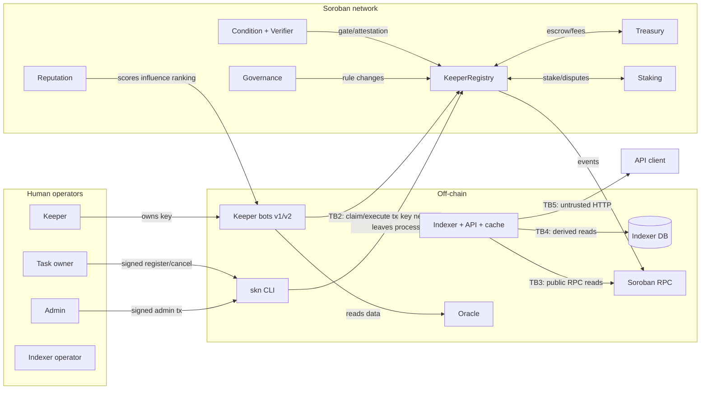

# System-wide threat model

This is the single threat model for the Soroban Keeper Network. Each epic has
its own security review (linked in
[Per-epic reviews](#per-epic-reviews)); this document covers the system as a
whole: the actors that cross component boundaries, the assets they can reach,
the trust boundaries between them, and the attack paths that result.

Scope: the on-chain contracts (`keeper-registry`, `treasury`, governance,
staking, reputation, task conditions, verifiers), the indexer and its API,
the v1 and v2 keeper bots, and the `skn` CLI. Off-chain operator practices
are in scope where they affect an asset.

## Actors

| Actor | What they control | Privilege |
| --- | --- | --- |
| **Admin** | `pause`/`unpause`, `set_fee_bps`, `set_min_reward`, `sweep_fees`, `transfer_admin`, upgrades, slash | Can change protocol rules and move protocol fees. Cannot move task escrow or keeper credits (I-5) |
| **Task owner** | Creates, cancels, extends and funds tasks | Can decide what is automated and what reward is offered. Cannot execute a task |
| **Keeper** | Claims and executes tasks, stakes, withdraws rewards | Earns rewards by doing work. Holds a signing key. Cannot change protocol rules |
| **Verifier** | Attests that an execution occurred | Can block a reward if it refuses to attest. Cannot create a reward |
| **Condition** | On-chain predicate that gates execution | Can make a task ineligible. Cannot move funds |
| **Oracle** | Supplies external data consumed by conditions and profitability checks | Can influence *whether* work is attempted. Cannot pay itself |
| **Indexer operator** | Runs the RPC indexer, API, cache and database | Reads all public chain events. Controls API availability and query results. Does not hold user keys |

A keeper may also be an admin or a task owner on a different task; roles are
per-action, not per-identity.

## Assets

- **Task escrow** — the reward tokens held by the registry for pending and
  claimed tasks.
- **Keeper credited balances** — earned but unwithdrawn rewards.
- **Staked collateral** — bonded and mid-unbond keeper stake, plus pending
  execution-dispute credits.
- **Protocol fees** — accrued fees that the admin may sweep.
- **Upgrade and pause authority** — the ability to change contract code or
  halt the system.
- **Signing keys** — keeper and admin keys. Leakage is irreversible.
- **API keys, RPC URLs and database URLs** — off-chain credentials; an RPC URL
  may embed a provider API key.
- **Indexer database and cache** — derived state that clients trust for
  reads; corruption is a correctness and availability attack even when the
  chain is safe.
- **Reputation and governance state** — scores and proposals/votes that
  influence which keepers are selected and what the protocol does next.

## Trust boundaries and diagram

Boundaries:

- **TB1 (CLI to chain).** The CLI holds signing keys. A key must never be
  echoed, logged or written to a temp file. Admin and deploy commands require
  an explicit confirmation naming the network.
- **TB2 (bot to chain).** The bot holds a keeper key and acts on public task
  data. A malicious task payload must not turn into an arbitrary privileged
  call; executors are registered per known task type.
- **TB3 (indexer to RPC).** RPC is an external input. Malformed or reorged
  events must not corrupt checkpoints or produce incorrect balances.
- **TB4 (indexer to database).** Derived state is a cache of the chain, not a
  second source of truth. A wrong value must be detectable by re-ingestion.
- **TB5 (indexer API to client).** HTTP responses cross a trust boundary.
  Inputs are rate-limited and validated; responses must not leak internal
  URLs, keys or other users' data.

## Attack paths

Each path names a mitigation or is explicitly accepted with a reason.

| # | Attack path | Impact | Mitigation / disposition |
| --- | --- | --- | --- |
| AP-1 | Admin (or stolen admin key) calls `sweep_fees` during normal operation | Protocol fees move early | **Mitigated:** sweep can only move accrued fees; I-5 property test proves task escrow and keeper credits are untouched. Admin key custody remains an accepted operational risk, documented in the CLI security review |
| AP-2 | Admin key is used against mainnet by a typo | Irreversible rule change | **Mitigated:** admin/deploy commands prompt with the resolved network and require explicit confirmation; see the CLI security review |
| AP-3 | Keeper key is logged, echoed from a key source, or left in a temp file | Full loss of keeper funds | **Mitigated:** key sources never echo secrets; error paths report the source name only; no temp files are used. Any new key source must meet this bar |
| AP-4 | Oracle or condition reports false data | Keeper executes a task that should be skipped, or is skipped incorrectly | **Partially mitigated:** oracle logging records inputs and the condition-fallback path is documented. A wrong oracle is an *accepted* risk. Reason: the protocol cannot judge external truth on-chain; keepers choose which oracles to trust and can withdraw from an untrusted one |
| AP-5 | Verifier withholds attestation | A keeper's execution is not rewarded | **Mitigated:** dispute resolution and pending execution credits keep the funds accounted for (I-1) and give a resolution path. A single verifier refusing is an accepted liveness risk, documented in the verifier design |
| AP-6 | Keeper races another keeper for the same claim | Wasted fee, double-work | **Mitigated:** v2 classifies a lost claim race as a normal competitive skip, not an error; claim is a single state transition on-chain |
| AP-7 | Reorg or malformed event corrupts the indexer | Clients read wrong state | **Mitigated:** reorg handling and idempotent ingestion; checkpoints advance only on confirmed data. Re-ingestion from the checkpoint recovers |
| AP-8 | API client floods `/v1` or opens unbounded WebSockets | Indexer outage | **Mitigated:** per-client rate limiting and WebSocket connection limits. The default is private deployment; see the exposure recommendation in the observability doc |
| AP-9 | RPC URL with an embedded API key is logged or used as a metric label | Credential leak into log pipeline or dashboards | **Mitigated:** the indexer startup log redacts the URL to scheme and host, and label rules ban full URLs. Database URLs and signing keys are likewise never logged or labelled |
| AP-10 | A renamed or undocumented metric hides a regression | Alerts silently stop firing | **Mitigated:** metric-name tests compare scraped names against the canonical catalogue in the observability doc |
| AP-11 | Upgrade key replaces contract code with malicious logic | Loss of all escrowed assets | **Accepted.** Upgrade authority is a deliberate governance capability, not a bug; it is gated by the admin confirmation flow and monitored by the contract state monitor. Risk is accepted because recoverability from a malicious upgrade is impossible and the authority must exist somewhere |
| AP-12 | Indexer operator returns forged query results | Clients act on false balances | **Partially mitigated:** clients can re-read the chain directly; responses are derived data. Accepted as a deployment trust assumption: the API is not a trust anchor and must not be treated as one |

## Per-epic reviews

This model links to every per-epic security review:

- [Staking security review](STAKING_SECURITY_REVIEW.md)
- [Treasury security review](TREASURY_SECURITY_REVIEW.md)
- [Governance security review](GOVERNANCE_SECURITY_REVIEW.md)
- [Reputation security review](REPUTATION_SECURITY_REVIEW.md)
- [Task conditions security review](TASK_CONDITIONS_SECURITY_REVIEW.md)
- [Indexer security review](INDEXER_SECURITY_REVIEW.md)
- [Keeper bot v2 security review](KEEPER_BOT_V2_SECURITY_REVIEW.md)

Supporting references: [invariants reference](INVARIANTS.md),
[observability and exposure](OBSERVABILITY.md),
[architecture](ARCHITECTURE.md),
[audit scope](AUDIT_SCOPE.md).
