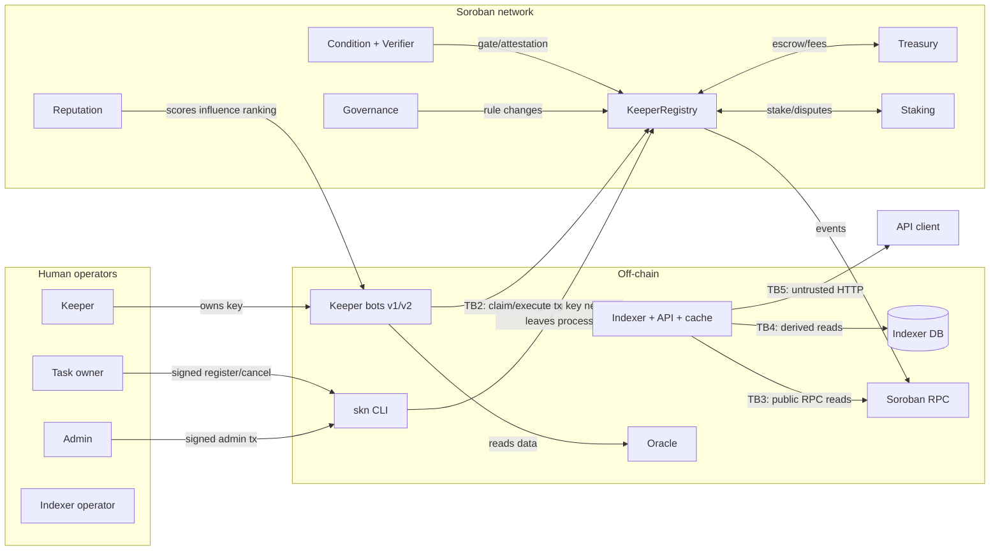

# System threat model and E19 retrospective

Status: internal source review complete for the documented baseline;
independent audit and mainnet release evidence outstanding.

Baseline: `22fc72304c950f539355330149dc30aef0b22a71`, with the dashboard,
release-readiness, indexer-limit, and audit-handoff changes stacked in the pull
requests linked by the delivery chain.

## System and assets

Soroban Keeper Network coordinates task escrow, keeper execution, optional
condition/verifier decisions, staking and disputes, treasury distribution,
governance, off-chain indexing, keeper bots, and an operator dashboard.

Assets requiring protection are:

- escrowed task rewards, keeper rewards, stake, fees, and treasury balances;
- administrator, governance, owner, keeper, and recipient authorization;
- task/verifier/dispute state integrity and event ordering;
- contract and indexer availability;
- keeper signing keys, API keys, deployment credentials, and release evidence;
- faithful, bounded indexing of public ledger data.

Public task, address, event, and contract-configuration data is not treated as
secret. Credentials, private signing material, and off-chain incident records
are secret even when the operations they authorize emit public events.

## Actors and trust boundaries

| Actor/boundary | Capability | Security expectation |
|---|---|---|
| Task owner | Funds and mutates owned tasks; selects verifier | Cannot spend other owners' escrow or bypass task-state rules. |
| Keeper | Claims and executes tasks; manages stake and rewards | Cannot receive duplicate payout or execute outside claim/verifier policy. |
| Contract admin | Pauses, changes bounded parameters, upgrades, sweeps, slashes | High-trust role; every action must require stored-admin authorization and emit evidence. |
| Governance participants | Propose, vote, queue, execute, cancel under policy | Snapshot/timelock/quorum rules must resist replay and later weakening. |
| Verifier/condition contract | Returns a decision during task evaluation | Untrusted code may reject, panic, or consume budget but must not move registry funds. |
| Reward token | Transfers value across contract boundary | Potentially adversarial callback; checks-effects-interactions and reentrancy tests apply. |
| Indexer client | Sends paths, filters, credentials, upgrades, and socket traffic | Fully untrusted; input and retained resources must be bounded. |
| Keeper bot/dashboard operator | Holds keys and submits transactions | Local secret storage and transaction review are trusted operational boundaries. |
| Release/deployment operator | Selects WASM, network, RPC, database, and proxy | Must produce independently reviewable release evidence. |

## Threats, controls, and status

| Threat | Primary controls | Status |
|---|---|---|
| Escrow theft, double payout, or fee/escrow mixing | State machine checks, CEI ordering, checked arithmetic, invariants I-1 through I-7, property/fuzz tests | Reviewed; independent audit pending. |
| Reentrancy through token or verifier calls | Effects before transfer, isolated verifier result, adversarial mocks and fuzz targets | Reviewed; residual coverage gaps are listed in `FUZZING.md`. |
| Unauthorized administration or involuntary admin transfer | `require_admin`, dual authorization for transfers, bounded setters, events | Reviewed; operational key custody remains external. |
| Stale claim, early dispute, or appeal replay | Ledger-bound windows, terminal-state checks, typed records | Reviewed in staking design/security review; mainnet evidence pending. |
| Governance replay, early execution, or threshold bypass | Proposal identity, voting snapshots, quorum/threshold checks, timelock, terminal states | Reviewed in governance security documents; external audit pending. |
| Malicious verifier steals funds or corrupts task state | Verifier has decision-only interface and is invoked before payout mutation | Design control reviewed; arbitrary verifier availability/cost remains an owner-selected risk. |
| Indexer SQL injection or error disclosure | Static SQL with binds, typed enums, generic public errors | No source-level finding. |
| Indexer request, socket, replay, or identity exhaustion | Authenticated identity selection, bounded token buckets, pagination, socket permits, replay and idle caps | Source controls implemented; production load/churn test pending. |
| Signing/API key disclosure | Environment-only bot keys, validation/redaction tests, hashed indexer API secrets, no client-side private keys | Source controls implemented; deployment secret store pending. |
| Wrong-network or wrong-contract transaction | Explicit network/contract configuration and wallet network checks | Dashboard/operator control implemented; human confirmation remains required. |
| Supply-chain or release substitution | Locked dependencies, CI, reproducible WASM/hash checklist, pinned audit baseline | Release evidence and independent audit pending. |

## Security invariants

The audit must preserve the numbered registry invariants in `ARCHITECTURE.md`,
the treasury solvency invariant in `TREASURY_DESIGN.md`, the staking and
governance invariants in their design documents, and these cross-system rules:

1. No off-chain service can authorize an on-chain action by itself.
2. A verifier can reject an execution but cannot transfer registry funds.
3. Pause blocks new exposure but not documented fund-recovery operations.
4. Failed or replayed terminal transitions do not advance state or pay twice.
5. Indexed state is reconstructible from ledger events and never overrides
   ledger truth.
6. Private keys and raw API secrets never enter contracts, events, browser
   storage, repository fixtures, or logs.

## E19 retrospective

### Reviewed

- Keeper-registry task, administration, batching, staking, reputation,
  verifier, storage/TTL, and upgrade surfaces.
- Treasury distribution and recipient administration.
- Governance proposal lifecycle and token authority.
- Indexer authentication, rate limiting, query validation, data exposure, and
  WebSocket resource retention.
- Keeper-bot key hygiene, dashboard transaction boundary, deployment guidance,
  fuzzing/property coverage, and audit documentation.

### Resolved in source

- Indexer keys are verified before selecting a rate-limit identity; invalid and
  revoked keys cannot mint buckets.
- REST history/list/aggregate queries have explicit request bounds.
- WebSocket sessions have global/per-client permits, validated filters,
  bounded replay, and idle/lag closure.
- Nightly fuzzing publishes source coverage and an explicit unreached-entry
  point ledger.
- Bot signing-key validation rejects placeholders and avoids secret reflection.
- A single audit-package index now pins scope and links threat, invariant,
  access-control, build, known-risk, and readiness evidence.

### Accepted or outstanding risk

- Mainnet remains `NO-GO` until every required item in
  `MAINNET_READINESS.md` has immutable evidence and named approval.
- No independent audit report is committed for the complete current system.
- Reputation self-dealing/decay limitations remain documented in
  `REPUTATION_SECURITY_REVIEW.md`; do not enable a restrictive reputation
  floor until the recommended mitigation is reviewed.
- Verifier resource use and correctness are selected by task owners; the core
  contract limits the blast radius but cannot make arbitrary verifier logic
  reliable.
- Indexer limits are process-local defaults. Proxy/fleet limits and production
  capacity must be tested and monitored.
- The exact fuzz gaps in `FUZZING.md` remain accepted test debt, not evidence
  that those entry points are unsafe or covered.

### Audit status

E19 documentation and internal source review are complete for handoff. The
system is not represented as independently audited or mainnet approved. The
external auditor should start at `AUDIT_PACKAGE.md`, record findings against
the pinned baseline, and update this retrospective and the readiness checklist
with immutable report links and explicit risk acceptance.
# System-wide threat model

This is the single threat model for the Soroban Keeper Network. Each epic has
its own security review (linked in
[Per-epic reviews](#per-epic-reviews)); this document covers the system as a
whole: the actors that cross component boundaries, the assets they can reach,
the trust boundaries between them, and the attack paths that result.

Scope: the on-chain contracts (`keeper-registry`, `treasury`, governance,
staking, reputation, task conditions, verifiers), the indexer and its API,
the v1 and v2 keeper bots, and the `skn` CLI. Off-chain operator practices
are in scope where they affect an asset.

## Actors

| Actor | What they control | Privilege |
| --- | --- | --- |
| **Admin** | `pause`/`unpause`, `set_fee_bps`, `set_min_reward`, `sweep_fees`, `transfer_admin`, upgrades, slash | Can change protocol rules and move protocol fees. Cannot move task escrow or keeper credits (I-5) |
| **Task owner** | Creates, cancels, extends and funds tasks | Can decide what is automated and what reward is offered. Cannot execute a task |
| **Keeper** | Claims and executes tasks, stakes, withdraws rewards | Earns rewards by doing work. Holds a signing key. Cannot change protocol rules |
| **Verifier** | Attests that an execution occurred | Can block a reward if it refuses to attest. Cannot create a reward |
| **Condition** | On-chain predicate that gates execution | Can make a task ineligible. Cannot move funds |
| **Oracle** | Supplies external data consumed by conditions and profitability checks | Can influence *whether* work is attempted. Cannot pay itself |
| **Indexer operator** | Runs the RPC indexer, API, cache and database | Reads all public chain events. Controls API availability and query results. Does not hold user keys |

A keeper may also be an admin or a task owner on a different task; roles are
per-action, not per-identity.

## Assets

- **Task escrow** — the reward tokens held by the registry for pending and
  claimed tasks.
- **Keeper credited balances** — earned but unwithdrawn rewards.
- **Staked collateral** — bonded and mid-unbond keeper stake, plus pending
  execution-dispute credits.
- **Protocol fees** — accrued fees that the admin may sweep.
- **Upgrade and pause authority** — the ability to change contract code or
  halt the system.
- **Signing keys** — keeper and admin keys. Leakage is irreversible.
- **API keys, RPC URLs and database URLs** — off-chain credentials; an RPC URL
  may embed a provider API key.
- **Indexer database and cache** — derived state that clients trust for
  reads; corruption is a correctness and availability attack even when the
  chain is safe.
- **Reputation and governance state** — scores and proposals/votes that
  influence which keepers are selected and what the protocol does next.

## Trust boundaries and diagram

Boundaries:

- **TB1 (CLI to chain).** The CLI holds signing keys. A key must never be
  echoed, logged or written to a temp file. Admin and deploy commands require
  an explicit confirmation naming the network.
- **TB2 (bot to chain).** The bot holds a keeper key and acts on public task
  data. A malicious task payload must not turn into an arbitrary privileged
  call; executors are registered per known task type.
- **TB3 (indexer to RPC).** RPC is an external input. Malformed or reorged
  events must not corrupt checkpoints or produce incorrect balances.
- **TB4 (indexer to database).** Derived state is a cache of the chain, not a
  second source of truth. A wrong value must be detectable by re-ingestion.
- **TB5 (indexer API to client).** HTTP responses cross a trust boundary.
  Inputs are rate-limited and validated; responses must not leak internal
  URLs, keys or other users' data.

## Attack paths

Each path names a mitigation or is explicitly accepted with a reason.

| # | Attack path | Impact | Mitigation / disposition |
| --- | --- | --- | --- |
| AP-1 | Admin (or stolen admin key) calls `sweep_fees` during normal operation | Protocol fees move early | **Mitigated:** sweep can only move accrued fees; I-5 property test proves task escrow and keeper credits are untouched. Admin key custody remains an accepted operational risk, documented in the CLI security review |
| AP-2 | Admin key is used against mainnet by a typo | Irreversible rule change | **Mitigated:** admin/deploy commands prompt with the resolved network and require explicit confirmation; see the CLI security review |
| AP-3 | Keeper key is logged, echoed from a key source, or left in a temp file | Full loss of keeper funds | **Mitigated:** key sources never echo secrets; error paths report the source name only; no temp files are used. Any new key source must meet this bar |
| AP-4 | Oracle or condition reports false data | Keeper executes a task that should be skipped, or is skipped incorrectly | **Partially mitigated:** oracle logging records inputs and the condition-fallback path is documented. A wrong oracle is an *accepted* risk. Reason: the protocol cannot judge external truth on-chain; keepers choose which oracles to trust and can withdraw from an untrusted one |
| AP-5 | Verifier withholds attestation | A keeper's execution is not rewarded | **Mitigated:** dispute resolution and pending execution credits keep the funds accounted for (I-1) and give a resolution path. A single verifier refusing is an accepted liveness risk, documented in the verifier design |
| AP-6 | Keeper races another keeper for the same claim | Wasted fee, double-work | **Mitigated:** v2 classifies a lost claim race as a normal competitive skip, not an error; claim is a single state transition on-chain |
| AP-7 | Reorg or malformed event corrupts the indexer | Clients read wrong state | **Mitigated:** reorg handling and idempotent ingestion; checkpoints advance only on confirmed data. Re-ingestion from the checkpoint recovers |
| AP-8 | API client floods `/v1` or opens unbounded WebSockets | Indexer outage | **Mitigated:** per-client rate limiting and WebSocket connection limits. The default is private deployment; see the exposure recommendation in the observability doc |
| AP-9 | RPC URL with an embedded API key is logged or used as a metric label | Credential leak into log pipeline or dashboards | **Mitigated:** the indexer startup log redacts the URL to scheme and host, and label rules ban full URLs. Database URLs and signing keys are likewise never logged or labelled |
| AP-10 | A renamed or undocumented metric hides a regression | Alerts silently stop firing | **Mitigated:** metric-name tests compare scraped names against the canonical catalogue in the observability doc |
| AP-11 | Upgrade key replaces contract code with malicious logic | Loss of all escrowed assets | **Accepted.** Upgrade authority is a deliberate governance capability, not a bug; it is gated by the admin confirmation flow and monitored by the contract state monitor. Risk is accepted because recoverability from a malicious upgrade is impossible and the authority must exist somewhere |
| AP-12 | Indexer operator returns forged query results | Clients act on false balances | **Partially mitigated:** clients can re-read the chain directly; responses are derived data. Accepted as a deployment trust assumption: the API is not a trust anchor and must not be treated as one |

## Per-epic reviews

This model links to every per-epic security review:

- [Staking security review](STAKING_SECURITY_REVIEW.md)
- [Treasury security review](TREASURY_SECURITY_REVIEW.md)
- [Governance security review](GOVERNANCE_SECURITY_REVIEW.md)
- [Reputation security review](REPUTATION_SECURITY_REVIEW.md)
- [Task conditions security review](TASK_CONDITIONS_SECURITY_REVIEW.md)
- [Indexer security review](INDEXER_SECURITY_REVIEW.md)
- [Keeper bot v2 security review](KEEPER_BOT_V2_SECURITY_REVIEW.md)

Supporting references: [invariants reference](INVARIANTS.md),
[observability and exposure](OBSERVABILITY.md),
[architecture](ARCHITECTURE.md),
[audit scope](AUDIT_SCOPE.md).
