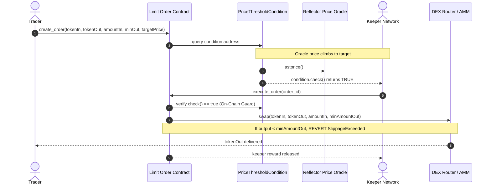

# Oracle-Driven Limit Order Keeper Task

This example demonstrates how to build an oracle-driven automated limit order execution contract on Soroban combining the **Price-Threshold Task Condition Contract** (`contracts/conditions/price-threshold`) with DEX swap execution and strict **slippage protection**.

---

## 1. Architecture & Mechanics

DeFi limit orders require executing a swap automatically when the market price reaches a target threshold. 

Relying on off-chain price checks in keeper bots is insecure because:
- Keepers could lie about the market price to trigger unprofitable swaps.
- Frontrunning bots could manipulate timestamps.

By coupling the limit order with the **Soroban Keeper Network** and on-chain conditions:
1. The user creates a limit order depositing `token_in` and specifying `target_price` and `min_amount_out` (slippage boundary).
2. The task attaches the on-chain `PriceThresholdCondition` contract (epic E11).
3. The keeper network only allows the task to be claimed when the on-chain condition evaluates to `true` against the live oracle feed.
4. When executing the swap, **the smart contract enforces that the DEX output meets or exceeds `min_amount_out`**. If slippage is violated, the transaction aborts and funds are protected.



---

## 2. Acceptance Criteria Verification

### Criterion 1: Uses the Price-Threshold Condition, Not an Off-Chain Check
The `execute_order` method does not accept or trust any caller-supplied price. It directly queries the attached on-chain condition contract:
```rust
let condition_client = ConditionClient::new(&env, &order.condition_contract);
if !condition_client.check() {
    return Err(OrderError::PriceConditionNotMet);
}
```
If the oracle price does not satisfy the condition, the transaction reverts on-chain.

### Criterion 2: Slippage Protection Enforced in Swap Call
When executing the DEX swap, the user's `min_amount_out` is passed to the router, and the contract asserts that received tokens satisfy the threshold:
```rust
if actual_amount_out < order.min_amount_out {
    return Err(OrderError::SlippageExceeded);
}
```
If price impact, frontrunning, or liquidity shifts cause the received tokens to fall below `min_amount_out`, the swap reverts, keeping the order open and preventing economic loss.

---

## 3. Running the Tests

To verify:
1. The task uses the price-threshold condition, rejecting off-chain overrides.
2. Slippage protection is enforced in the swap call.

```bash
npm test
```

Sample output:
```text
✔ Criterion 1: Task uses on-chain price-threshold condition, rejecting off-chain overrides
✔ Criterion 2: Slippage protection is strictly enforced in the swap call
```
