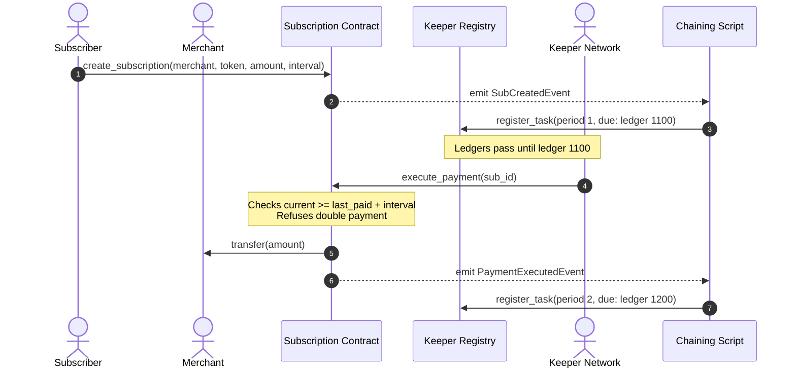

# Recurring Payment & Subscription Keeper Task

This example demonstrates how to build an autonomous recurring payment and subscription protocol on Soroban powered by the **Soroban Keeper Network**.

---

## 1. Problem & Architecture

Subscription and recurring billing systems (SaaS, content subscriptions, utility payroll, recurring debt servicing) require scheduled payments at regular intervals.

On blockchain networks, smart contracts cannot trigger themselves. Traditional solutions rely on centralized backend servers running cron jobs, which introduces:
- A single point of failure (if the server crashes, subscriptions stall).
- Trust assumptions (centralized keys holding transfer allowances).

Using the **Soroban Keeper Network**:
1. The subscriber creates a subscription authorizing the contract to pull `amount` every `interval_ledgers`.
2. A decentralized keeper bot monitors the network and claims the `execute_payment(subscription_id)` task when due.
3. The on-chain contract guarantees that **double payments within the same billing period are strictly rejected**.
4. An automated event listener / task chaining script **automatically registers the next period's keeper task** upon successful execution.



---

## 2. On-Chain Protection Against Double Payments

The contract enforces double-payment prevention at the smart contract level:

```rust
let next_due_ledger = sub.last_payment_ledger.checked_add(sub.interval_ledgers)?;
if current_ledger < next_due_ledger {
    return Err(SubscriptionError::PaymentNotDueYet);
}
```

Even if multiple keepers attempt to claim the task or call `execute_payment` prematurely or repeatedly within the same period, only the first call at or after `next_due_ledger` succeeds. Any subsequent call in the same period fails with `PaymentNotDueYet`.

---

## 3. Automated Next-Period Task Registration

In `scripts/register-next-task.ts`, the `TaskChainingAutomator` receives execution events and prepares the next task payload:

- Calculates `dueLedger = currentLedger + intervalLedgers`.
- Binds a time-window condition to gate claiming until the due ledger is reached.
- Allocates keeper incentive rewards from the subscription fee reserve.

---

## 4. Running the Tests

To verify both acceptance criteria:
1. Double payments within a period are refused.
2. Next period's task is registered after execution.

```bash
npm test
```

Sample output:
```text
✔ Criterion 1: Contract refuses double payment within the same period
✔ Criterion 2: Script registers the next period's task after each execution
```
