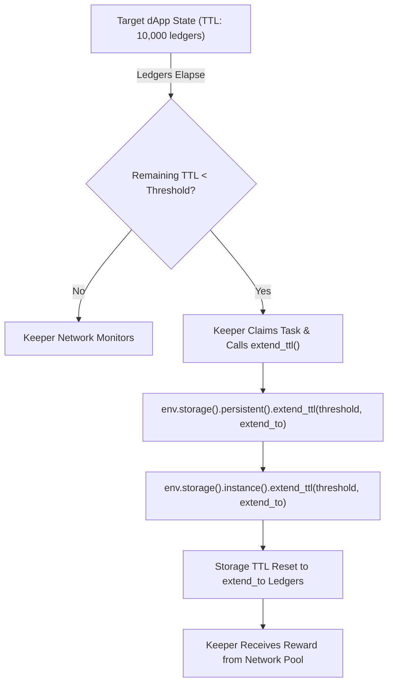

# Soroban TTL-Extension Keeper Task Example

This example demonstrates how a Soroban dApp can leverage the **Soroban Keeper Network** to keep its storage entries (both instance storage and persistent storage) permanently live without requiring manual operator intervention or burdening end-users with storage rent management.

---

## 1. Problem: Soroban State Archival & Storage TTL

On Stellar's Soroban smart contract platform, state entries (instance and persistent storage) are governed by a **Time-To-Live (TTL)** measured in ledgers (~5 seconds per ledger).

- Every entry has a natural lifetime upon creation.
- As new ledgers close, the remaining TTL counts down towards zero.
- If the TTL reaches zero, Soroban **archives** the entry.
- Once archived, an entry cannot be read or modified by contract calls.
- Restoring archived state requires a special `RestoreFootprintOp` transaction, which incurs expensive restoration rent penalties (typically 10× standard rent plus base network fees).

For vital dApp state (e.g., token balances, liquidity pool reserves, staking parameters, oracle feeds, governance proposals), allowing state to expire causes service disruption and expensive recovery.

---

## 2. Solution: Automated Keeper Renewal

Instead of relying on centralized cron jobs or manual multisig transactions, the dApp owner registers a **recurring keeper task** with the Soroban Keeper Network:



---

## 3. Contract Architecture

The example contract in `contracts/src/lib.rs` implements:

- `init(admin, initial_value)`: sets up instance storage and persistent storage keys with an initial safety TTL.
- `extend_ttl(threshold, extend_to)`: permissionless entry point callable by any keeper when the task triggers.
  - Calls `env.storage().instance().extend_ttl(threshold, extend_to)`
  - Calls `env.storage().persistent().extend_ttl(&DataKey::Record, threshold, extend_to)`
  - Emits the `(symbol!("ttl_ext"), threshold, extend_to, count)` event.
- `get_record()`: reads persistent state to verify liveness.
- `set_record(admin, value)`: updates state (restricted to admin).

---

## 4. Cost Model for the dApp Owner

Understanding the cost model is essential for sizing keeper rewards and budget allocations.

### Total Owner Cost Formula
$$\text{Total Cost per Extension} = \text{Soroban Storage Rent} + \text{Keeper Execution Fee} + \text{Keeper Reward}$$

### 1. Soroban Storage Rent (Network Protocol Fee)
On Soroban, persistent storage rent is charged per byte per ledger extended:
$$\text{Rent Stroops} = \frac{\text{Bytes} \times \Delta\text{Ledgers} \times 25}{10,000}$$
- For a **512-byte** state entry extended by **10,000 ledgers** (~13.8 hours):
  $$\text{Rent} = \frac{512 \times 10,000 \times 25}{10,000} = 12,800\text{ stroops } (0.00128\text{ XLM})$$

### 2. Keeper Execution Fee (Transaction Gas)
The resource and CPU fee to submit the `extend_ttl` transaction to the network:
$$\text{Gas Fee} \approx 15,000\text{ stroops } (0.0015\text{ XLM})$$

### 3. Keeper Reward (Incentive)
The reward paid out to the keeper bot for claiming and executing the task on time:
$$\text{Keeper Reward} = 50,000\text{ stroops } (0.0050\text{ XLM})$$

### Comparison: Active Keeper vs. Archival & State Restoration

| Metric | Active Keeper Extension | Archival & Restoration |
| :--- | :---: | :---: |
| **Storage Rent** | 12,800 stroops | 128,000 stroops (10× archival rate) |
| **Restoration Base Fee** | 0 stroops | 100,000 stroops |
| **Execution / Gas Fee** | 15,000 stroops | 25,000 stroops |
| **Keeper Incentive** | 50,000 stroops | N/A (requires manual admin tx) |
| **Total Cost** | **77,800 stroops (0.00778 XLM)** | **253,000 stroops (0.0253 XLM)** |
| **Savings** | **~69.2% saved** | Baseline |
| **Service Downtime** | **0 seconds (continuous liveness)** | **Hours/Days until manual recovery** |

---

## 5. Running the Tests

To verify acceptance criteria (storage staying live past its natural TTL and cost model calculations):

```bash
npm test
```

Sample output:
```text
✔ Criterion 1: Storage expires naturally without keeper intervention
✔ Criterion 1: Storage stays live past its natural TTL with keeper extension
✔ Criterion 1: Multiple recurring keeper cycles keep dApp state permanently live
✔ Criterion 2: Owner cost model calculates rent, fees, and archival savings accurately
```
