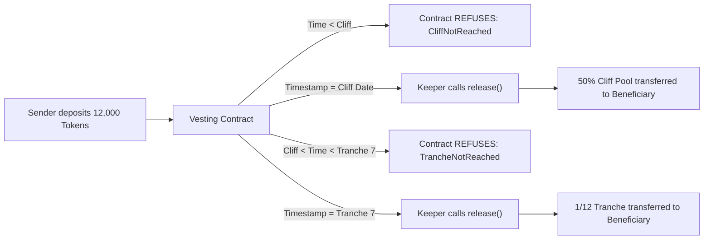

# Token Vesting Release Keeper Task

This example demonstrates how token vesting contracts with cliff and periodic tranche schedules can have their token releases autonomously triggered by the **Soroban Keeper Network**, removing the need for beneficiaries to manually track release dates and claim tokens.

---

## 1. Architecture & Security Guarantees

In traditional token vesting, beneficiaries must remember exact calendar dates to submit manual claim transactions, or project founders must manually distribute tokens every month.

With the **Soroban Keeper Network**:
1. At vesting initialization, keeper tasks are scheduled with **time-window conditions** corresponding to the cliff and each tranche release boundary.
2. When a milestone timestamp arrives, an incentivized keeper bot calls `release()`.
3. The smart contract validates on-chain timestamps:
   - **Releases before the cliff date are strictly refused by the contract** (`CliffNotReached`).
   - **Calls made between tranche boundaries are strictly refused by the contract** (`TrancheNotReached`).
   - **Premature claims cannot bypass contract validation**, regardless of who invokes the contract.
4. Matured tokens are automatically transferred directly into the beneficiary's wallet.



---

## 2. Tranche Mathematical Model

The contract computes vested amounts dynamically based on elapsed seconds:

$$\text{Elapsed} = \max(0, \text{CurrentTimestamp} - \text{StartTimestamp})$$
$$\text{TranchesElapsed} = \min\left(\text{NumTranches}, \left\lfloor\frac{\text{Elapsed}}{\text{TrancheInterval}}\right\rfloor\right)$$
$$\text{TotalVested} = \frac{\text{TotalAmount} \times \text{TranchesElapsed}}{\text{NumTranches}}$$
$$\text{Releasable} = \text{TotalVested} - \text{AlreadyReleased}$$

If $\text{CurrentTimestamp} < \text{CliffTimestamp}$ or $\text{Releasable} \le 0$, the contract aborts with an explicit error code, preventing any unauthorized or premature token distributions.

---

## 3. Running the Tests

To verify:
1. Releases before their date are refused by the contract.
2. Tests cover each tranche boundary.

```bash
npm test
```

Sample output:
```text
✔ Criterion 1: Releases before their date are strictly refused by the contract
✔ Criterion 2: Tests cover each tranche boundary across full vesting lifecycle
```
